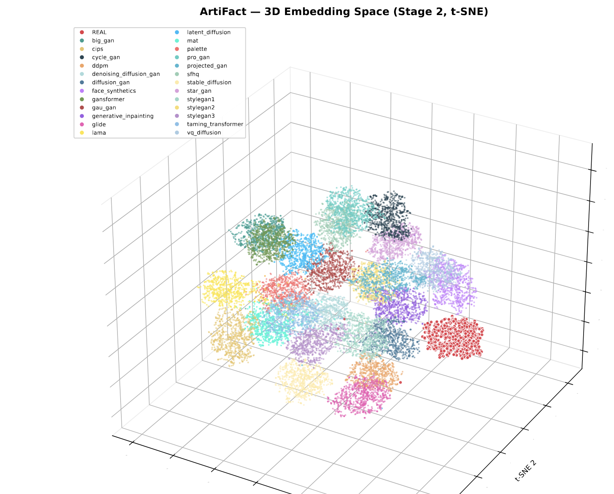

# Analisi degli embedding di immagini reali e sintetiche

Progetto sviluppato per la mia **tesi di laurea triennale in Informatica** presso l'**Università degli Studi di Salerno**.

L'obiettivo del lavoro è analizzare le rappresentazioni numeriche (*embedding*) di immagini reali e immagini generate artificialmente, per capire quanto le diverse classi siano distinguibili tra loro e quali caratteristiche emergano applicando tecniche di **Machine Learning**.

📄 **[Leggi la tesi completa](Tesi_Elettronica_Francesco_Lamanna.pdf)**

## Il progetto

L'analisi è stata svolta su **20.716 embedding**, ciascuno composto da **256 valori**, suddivisi in **26 classi**: una relativa alle immagini reali (`REAL`) e 25 associate a diversi generatori di immagini sintetiche.

Sono state utilizzate diverse tecniche per esplorare e confrontare i dati:

- **Analisi delle distanze:** distanze euclidea, coseno e Mahalanobis, per studiare le somiglianze tra le classi.
- **Classificazione:** Logistic Regression, Random Forest e Gaussian Naive Bayes, con valutazione tramite matrici di confusione e metriche di classificazione.
- **Clustering:** K-Means e DBSCAN, per analizzare come gli embedding si raggruppano nello spazio e distinguere punti *core*, *border* e *noise*.
- **Analisi dei vicini:** K-Nearest Neighbors e confronto tra vicini delle diverse classi.
- **Visualizzazione:** t-SNE in tre dimensioni, per osservare la distribuzione degli embedding e gli effetti del filtraggio dei punti.

Gli embedding sono già presenti nel progetto: il codice si concentra sulla **loro analisi**, non sulla generazione delle immagini o sull'addestramento dei modelli che li hanno estratti.

## Visualizzazioni



Sono disponibili anche alcune visualizzazioni interattive:

- [Punti core](tsne_html/Core.html)
- [Punti border](tsne_html/Border.html)
- [Punti noise](tsne_html/Noise.html)
- [Confronto prima e dopo il filtraggio](tsne_html/tsne_before_after_remove_noise.html)

Per esplorare i grafici interattivi è sufficiente scaricare i file HTML e aprirli nel browser.

## Tecnologie utilizzate

**Python**, con le librerie **NumPy**, **Pandas**, **Scikit-learn**, **SciPy** e **Plotly**.

## Struttura del repository

```text
Tesi/
├── full_embeddings_artifacts/
│   ├── clustering/      # K-Means e visualizzazione
│   ├── embeddings/      # Distanze, classificazione e analisi dei vicini
│   │   └── dbscan/      # Esperimenti con filtraggio DBSCAN
│   ├── meta.json        # Nomi delle classi
│   ├── proj_train_head.npy
│   └── y_train.npy
├── tsne_html/            # Grafici interattivi
└── Tesi_Elettronica_Francesco_Lamanna.pdf
```

## Esecuzione

Per eseguire gli script è necessario avere Python e le librerie utilizzate nel progetto. È possibile installarle con:

```bash
pip install numpy pandas scikit-learn scipy plotly openpyxl
```

Gli script sono indipendenti e vanno eseguiti dalla **cartella principale del repository**, perché caricano i dati tramite percorsi relativi. Per esempio:

```bash
python full_embeddings_artifacts/embeddings/euclidean_distance.py
```

## Tesi

Il repository raccoglie il codice e le visualizzazioni realizzate durante il lavoro di tesi. Per una descrizione più completa delle metodologie e delle analisi, è disponibile il **[PDF della tesi](Tesi_Elettronica_Francesco_Lamanna.pdf)**.

**Autore:** Francesco Lamanna
